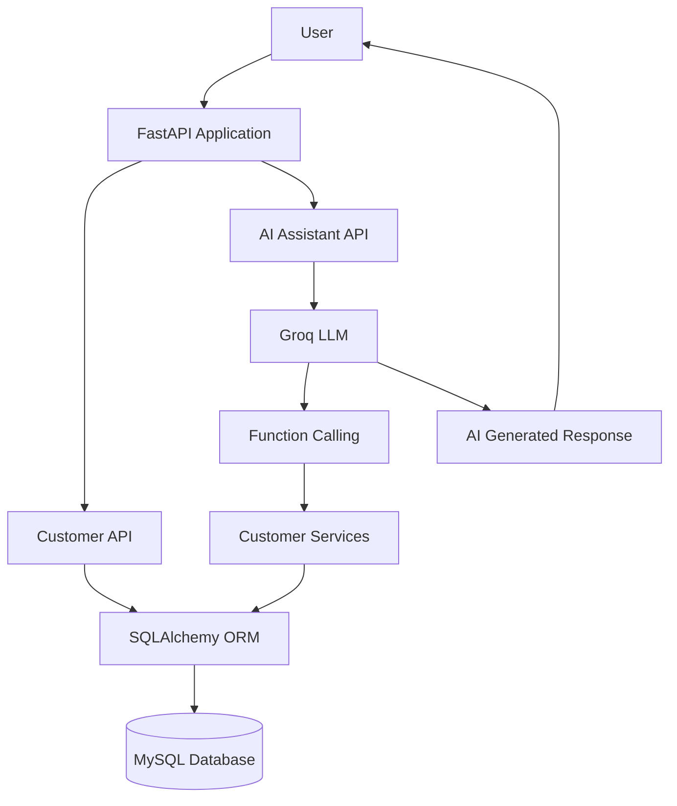
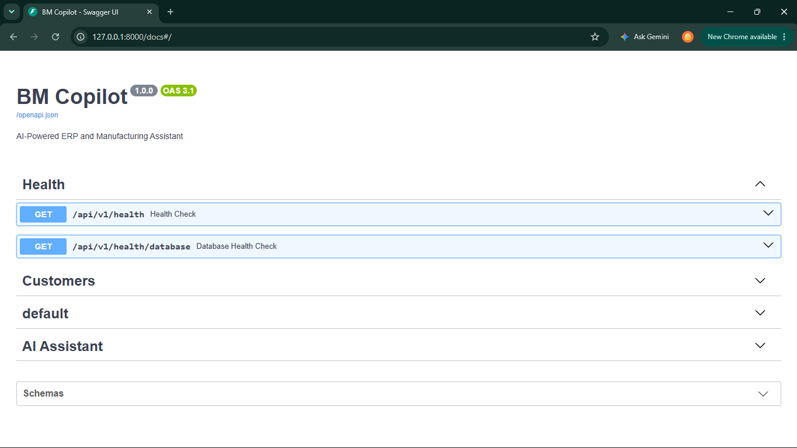
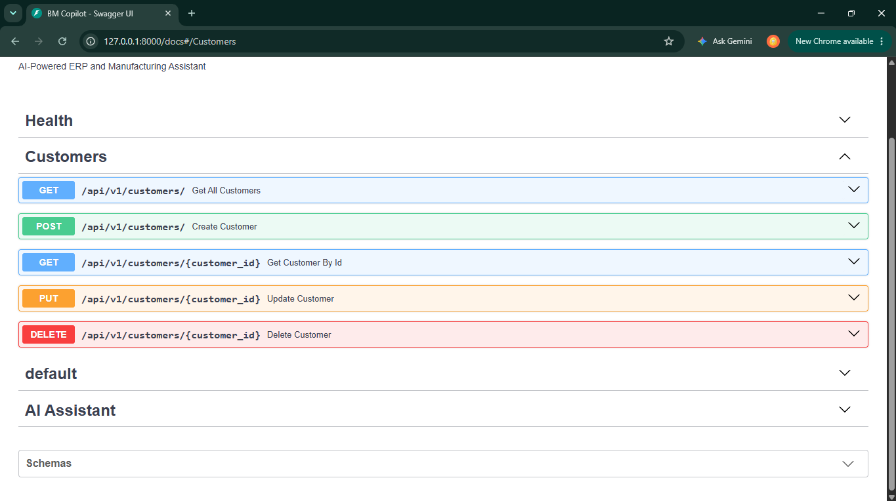
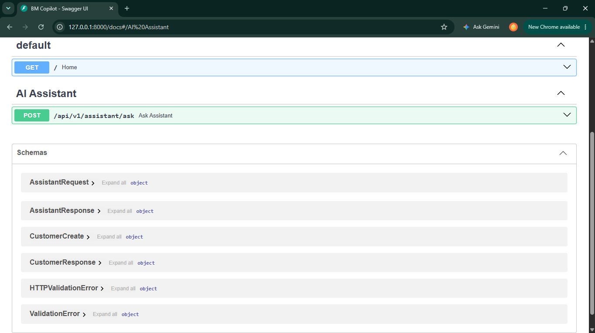

# BM Copilot – AI-Powered ERP and Manufacturing Assistant

BM Copilot is an AI-powered ERP assistant designed to simplify customer data management and provide natural-language access to customer information.

The application combines **FastAPI, MySQL, and Groq LLM integration** to build an intelligent backend assistant that can retrieve and answer questions using real database records.

## Features

- **Customer Management (CRUD):** Create, retrieve, update, and delete customer records.
- **MySQL Integration:** Store and manage customer information using MySQL.
- **AI Assistant:** Ask questions about customer records using natural language.
- **Groq LLM Integration:** Generate AI responses using the Groq API.
- **Function Calling:** Allow the AI model to call predefined Python functions to retrieve customer data.
- **Input Validation:** Validate API requests using Pydantic.
- **API Documentation:** Interactive API documentation using Swagger UI.

## Technology Stack

| Category | Technology |
|---|---|
| Backend | Python, FastAPI |
| Database | MySQL |
| ORM | SQLAlchemy |
| Data Validation | Pydantic |
| AI Integration | Groq API |
| AI Model | openai/gpt-oss-120b |
| API Testing | Swagger UI |
| Development | Visual Studio Code |

## Project Structure

```text
BM-Copilot/
│
├── backend/
│   ├── app/
│   │   ├── api/
│   │   ├── core/
│   │   ├── models/
│   │   ├── schemas/
│   │   ├── security/
│   │   └── services/
│   │
│   ├── .env.example
│   ├── requirements.txt
│   └── create_tables.py
│
├── database/
├── docs/
│   ├── health-api.png
│   ├── customer-api.png
│   └── ai-assistant-api.png
├── frontend/
├── .gitignore
└── README.md
```

## API Endpoints

| Method | Endpoint | Description |
|---|---|---|
| GET | `/api/v1/health` | Check application health |
| GET | `/api/v1/health/database` | Check database connection |
| POST | `/api/v1/customers/` | Create a customer |
| GET | `/api/v1/customers/` | Retrieve all customers |
| GET | `/api/v1/customers/{customer_id}` | Retrieve a customer |
| PUT | `/api/v1/customers/{customer_id}` | Update a customer |
| DELETE | `/api/v1/customers/{customer_id}` | Delete a customer |
| POST | `/api/v1/assistant/ask` | Ask the AI assistant |

## Installation and Setup

### 1. Clone the repository

```bash
git clone https://github.com/ashok-genai/BM-Copilot.git
cd BM-Copilot
```

### 2. Navigate to the backend

```bash
cd backend
```

### 3. Create a virtual environment

```bash
python -m venv venv
```

### 4. Activate the virtual environment

Windows PowerShell:

```powershell
.\venv\Scripts\Activate.ps1
```

### 5. Install dependencies

```bash
pip install -r requirements.txt
```

### 6. Configure environment variables

Create a `.env` file using `.env.example` as a template.

Configure your MySQL database credentials and Groq API key in `.env`.

Never upload your actual `.env` file or API keys to GitHub.

### 7. Start the application

```bash
python -m uvicorn app.main:app --reload
```

### 8. Access API documentation

Open:

http://127.0.0.1:8000/docs

## Example AI Assistant Queries

Try asking:

- How many customers do we have in our database?
- Show me all customers and their company names.
- Find customer CUST001 and show me their details.
- Find customer CUST999.

The AI assistant uses predefined database functions to retrieve customer information rather than inventing customer records.

## Architecture Overview



## API Documentation

BM Copilot provides interactive API documentation through Swagger UI.

### Health API



### Customer Management API



### AI Assistant API



## Project Status

The current backend MVP includes customer CRUD operations, MySQL connectivity, Groq integration, AI function calling, and request validation.

## Future Enhancements

- Frontend user interface
- Authentication and authorization
- Inventory management
- Manufacturing operations
- Retrieval-Augmented Generation (RAG)

## Author

Developed as a personal portfolio project to explore AI integration with ERP-style backend applications.